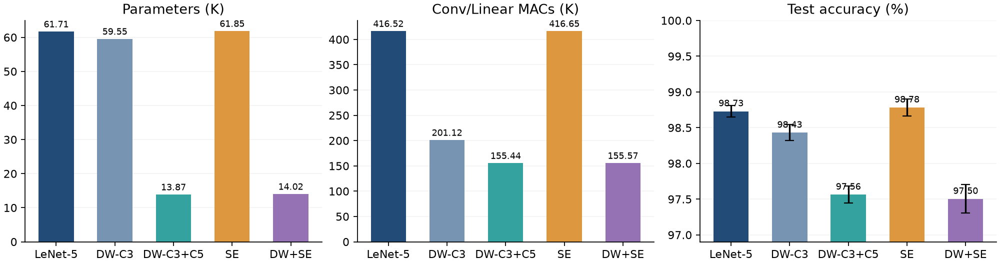
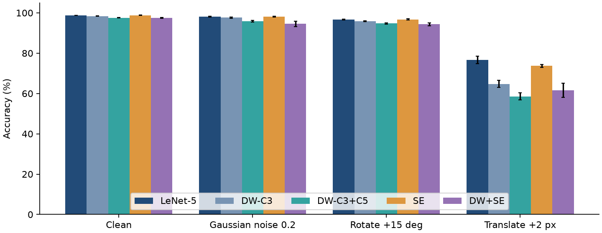

# LeNet Digit Lab

用 PyTorch 从零实现 LeNet-5，依据逐层开销设计双位置轻量化卷积，并以 SE 通道注意力检验压缩后的精度补偿。提供本地手写画布、单字图片上传、五种模型切换与概率展示。


## 设计思路

先实现经典网络，再定位开销来源。C3 在多个空间位置执行跨通道卷积，是计算热点；C5 将空间特征映射为高层表示，是参数热点。分别修改两处，再考察 SE，能够区分计算压缩、参数压缩与注意力各自的作用。

| 变体参数 | C3 | C5 | C3 激活后使用 SE |
|---|---|---|---|
| baseline | 标准卷积 | 标准卷积 | 否 |
| dw_c3 | 深度卷积 + 逐点卷积 | 标准卷积 | 否 |
| dw | 深度卷积 + 逐点卷积 | 深度卷积 + 逐点卷积 | 否 |
| se | 标准卷积 | 标准卷积 | 是 |
| dw_se | 深度卷积 + 逐点卷积 | 深度卷积 + 逐点卷积 | 是 |

C1 保持标准卷积，分解算子之间不增加额外激活。SE 瓶颈为 16→4→16，位于 C3 的 Tanh 与 S4 平均池化之间。深度可分离卷积与 SE 均为已有方法，项目重点是修改位置的选择、组合对照与输入适配。

## 1 准备环境

推荐 Python 3.12。本次使用 Windows、RTX 4060 Laptop、PyTorch 2.11.0+cu128、FP32。CPU 可以直接运行界面：

```powershell
git clone https://github.com/linpianpiann777-prog/lenet5-mnist-innovations.git
cd lenet5-mnist-innovations
py -3.12 -m venv .venv
.venv\Scripts\python -m pip install torch==2.11.0 --index-url https://download.pytorch.org/whl/cpu
.venv\Scripts\python -m pip install -r requirements.txt
```

GPU 训练请先按 [PyTorch 官方安装说明](https://pytorch.org/get-started/locally/) 选择适配的 CUDA 构建，再安装其他依赖。确认 torch.cuda.is_available() 为 True。后续 python 指所选虚拟环境解释器，例如 .venv\Scripts\python。

## 2 下载和处理 MNIST

```powershell
python download_data.py
```

从 Google CVDF 镜像下载四个压缩文件到 data/MNIST/raw/，逐一校验 MD5。已有且校验通过的文件会复用。数据不放入 Git 仓库，读取时还会验证 IDX 魔数和尺寸。

- 原始训练集 60000 张；按固定种子 2026 从每类抽取 600 张作验证集。
- 训练与验证为 54000 / 6000 张；官方测试集 10000 张。
- 灰度按 (x/255−0.5)/0.5 归一化，再四周各补两像素到 32×32，填充值 −1。
- 不使用水平翻转或预训练权重，所有结构共用同一划分。

下载目录：<https://storage.googleapis.com/cvdf-datasets/mnist/>。离线时把以下文件放到上述目录，不必解压：

```text
train-images-idx3-ubyte.gz
train-labels-idx1-ubyte.gz
t10k-images-idx3-ubyte.gz
t10k-labels-idx1-ubyte.gz
```

## 3 理解网络

```text
32×32×1
 → C1 Conv5×5 (6), Tanh → AvgPool2
 → C3 Conv5×5 (16), Tanh → optional SE → AvgPool2
 → C5 Conv5×5 (120), Tanh
 → F6 Linear (84), Tanh
 → Linear (10)
```

这是 LeNet-5 的现代分类实现：C3 全通道连接，平均池化无可训练缩放和偏置，线性分类头与交叉熵替代历史原版欧氏 RBF 输出。因此不将历史论文的准确率当作相同协议的直接基准。

标准卷积的主要乘加量为 H×W×Cin×Cout×k²，分解卷积为 H×W×(Cin×k²+Cin×Cout)。减少空间与通道耦合可以压缩开销，也会约束表达能力。只替换 C3 无法消除 C5 的参数开销，联合替换才能同时压缩两类热点。

## 4 训练和选择权重

```powershell
python train.py --epochs 15 --seeds 42 43 44 --output results_reproduce
```

使用 AdamW，初始学习率 0.002，权重衰减 0.0001，batch 256，余弦退火至 0.00002。每次保存逐轮损失与准确率，只用验证集选权重，并列保留最早轮次。测试集不参与训练或选择。98% 是预设的基线项目目标，区别于复现论文基准。

默认五组结构、每组三个种子、每次 15 轮，共 225 轮。为保护原始输出，已有最终指标的目录会拒绝覆盖。--variants 可指定子集，--budget-seconds 控制总训练预算。完整分析要求五组结构和三个默认种子齐全。

## 5 结构对比

以下来自仓库实际运行。准确率与 Macro-F1 为三个种子的均值 ± 样本标准差，分母为 n−1，不是置信区间。

| 模型 | 参数量 | MACs | 测试准确率 % | Macro F1 % |
|---|---:|---:|---:|---:|
| baseline | 61,706 | 416,520 | 98.73 ± 0.08 | 98.72 ± 0.08 |
| dw_c3 | 59,552 | 201,120 | 98.43 ± 0.11 | 98.42 ± 0.11 |
| dw | 13,872 | 155,440 | 97.56 ± 0.12 | 97.54 ± 0.12 |
| se | 61,854 | 416,648 | 98.78 ± 0.12 | 98.78 ± 0.12 |
| dw_se | 14,020 | 155,568 | 97.50 ± 0.20 | 97.48 ± 0.20 |

双位置 DW 参数减少 **77.52%**，主要 MACs 减少 **62.68%**，平均准确率变化 **−1.17 个百分点**。仅改 C3 的参数降幅为 **3.49%**，体现了修改位置对压缩目标的影响。

SE 平均准确率变化 **+0.05 个百分点**，增益较小，不能证明稳定优势；组合结构也没有自动恢复分解造成的精度损失。



MACs 只计 Conv/Linear，FLOPs 采用 2×MACs，不计池化、激活、偏置加法和 SE 逐元素乘法。减少 MACs 不保证更低实机延迟，GPU 和 CPU 测量分别保存在 results/analysis.json。

## 6 重算与核验

```powershell
python profile_models.py
python analyze.py --results results
python verify_results.py --results results
```

profile_models.py 输出逐层尺寸、参数和主要 MACs。analyze.py 重算汇总、学习曲线、混淆矩阵、错误图、扰动表现与配对统计。verify_results.py 将全部 15 份权重重新加载至 CPU，对完整测试集重放，核对概率、标签、正确数、Macro-F1、最佳轮次、梯度与索引完整性。

核验新训练目录：

```powershell
python analyze.py --results results_reproduce
python verify_results.py --results results_reproduce
```

图表统一输出到 figures/。完整分析还评估固定高斯噪声、旋转和平移；清洁输入会断言与原评分完全一致。配对 McNemar 检验只用种子 42，属于未做多重校正的探索性比较。跨硬件或不同软件构建可能存在浮点差异。



### 补充诊断图

```powershell
python extra_figures.py
```

生成类别分布、逐层开销、压缩精度权衡、种子波动、逐类别 F1、置信度分布、可靠性、阈值覆盖率、扰动下降与实机延迟等十张诊断图。图片位于 figures/extra_*.png，并提供同名矢量 PDF；源数据、固定分箱与 SHA256 记录于 results/extra_figures.json。只读取已有训练结果，不重新训练、不替换原始计时。中文绘图使用 Windows 微软雅黑字体。

## 7 启动单字识别

Windows 可双击 `open_visual.cmd` 一键打开，或运行 `python launch_visual.py`。启动器会复用已运行的本项目服务并打开浏览器；默认端口被其他服务占用时会明确提示。

```powershell
python app.py
```

访问 <http://127.0.0.1:7872>，Ctrl+C 停止。仓库提供已训练权重。另一个端口或另一组权重可用：

```powershell
python app.py --port 7873 --results results_reproduce
```

界面采用左侧设置、右侧原图与识别结果的双栏布局。测试样本支持上一张、下一张、编号跳转与随机选择；也可展开手写画布或上传单字图片。每次同时运行五种结构，展示预测、置信度、真实标签对照、参数量和 MACs。完整概率、前三候选和人工复核阈值位于结果区，并可保存带识别信息的 PNG。默认结构按平均验证准确率选择，完全并列时按既定顺序优先基线；部署种子固定为 42。

官方测试样本保留原始 28×28 图像，确保与评分一致。画布/上传执行背景极性判断、笔画裁剪、等比缩放和质心居中。softmax 未经校准，高置信度也可能出错。本系统只识别已切分的单个数字，不包含整页定位、字符切分或完整数字串识别。

```powershell
python inference.py --image samples/mnist_digit_7.png --mode mnist
python inference.py --image your_digit.png --variant dw --threshold 0.9 --output prediction.json
```

默认服务运行时，可检查 HTTP 推理：

```powershell
python test_app.py
```

检查针对默认端口和交付的 results，覆盖五种模型与保存预测一致性、模型切换、正确和错误标签、上传、阈值、PNG 下载与非法输入。图片仅在本机处理，服务绑定回环地址，未设计为公开网络服务。

## 项目文件

| 文件 | 功能 |
|---|---|
| models.py | 五种结构和复杂度计数 |
| data_utils.py / download_data.py | 数据获取、校验、读取、固定划分 |
| train.py | 训练、验证选择、测试和计时 |
| profile_models.py / analyze.py | 结构输出、多种子汇总及扰动分析 |
| verify_results.py | 独立重放与一致性检查 |
| inference.py | 单字预处理和命令行预测 |
| app.py / ui.html | 本地服务与交互界面 |
| test_app.py | HTTP 端到端检查 |
| results/ | 权重、完整预测、逐轮记录及指标 |
| figures/ / samples/ | 可重算图表、真实运行截图和示例 |

## 使用边界与后续方向

MNIST 指标不等于真实票据指标。平移检查揭示明显的位置敏感性，通道注意力没有自动几何对齐能力。当前没有独立业务数据集，也没有量化画布预处理对真实票据的收益。后续可分别验证平移/旋转增强、知识蒸馏和概率校准。

## 参考资料

- LeCun et al. Gradient-Based Learning Applied to Document Recognition, 1998. <https://doi.org/10.1109/5.726791>
- MNIST. <http://yann.lecun.com/exdb/mnist/>
- Hu et al. Squeeze-and-Excitation Networks, CVPR 2018. <https://openaccess.thecvf.com/content_cvpr_2018/html/Hu_Squeeze-and-Excitation_Networks_CVPR_2018_paper.html>
- Chollet. Xception, CVPR 2017. <https://openaccess.thecvf.com/content_cvpr_2017/html/Chollet_Xception_Deep_Learning_CVPR_2017_paper.html>

代码采用 MIT 许可证，数据和引用资料遵循各自使用条件。
